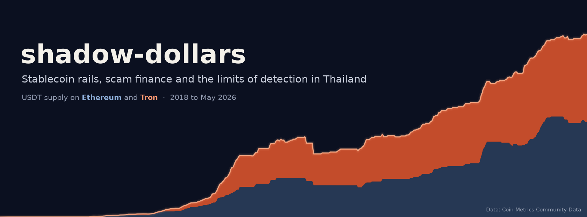
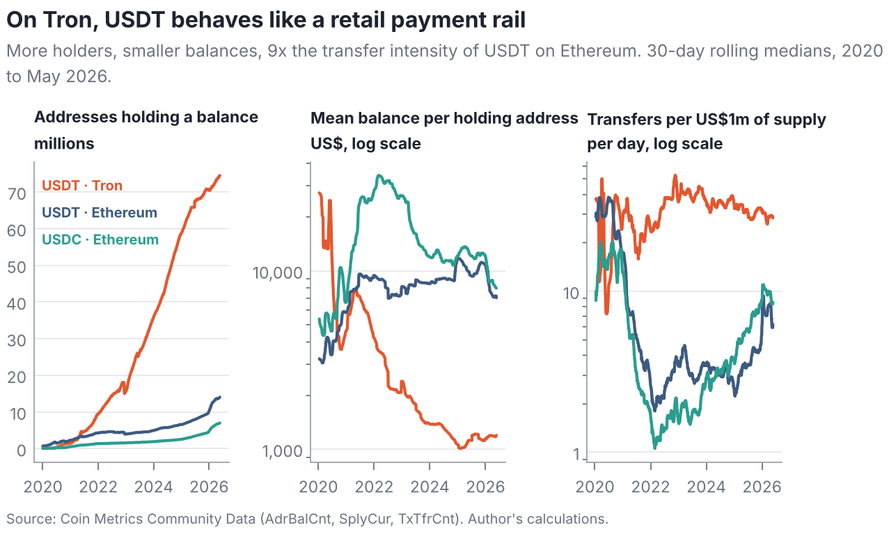
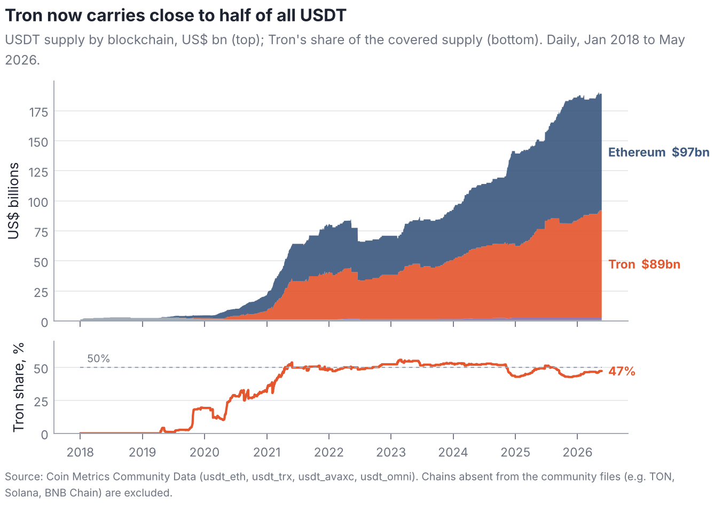
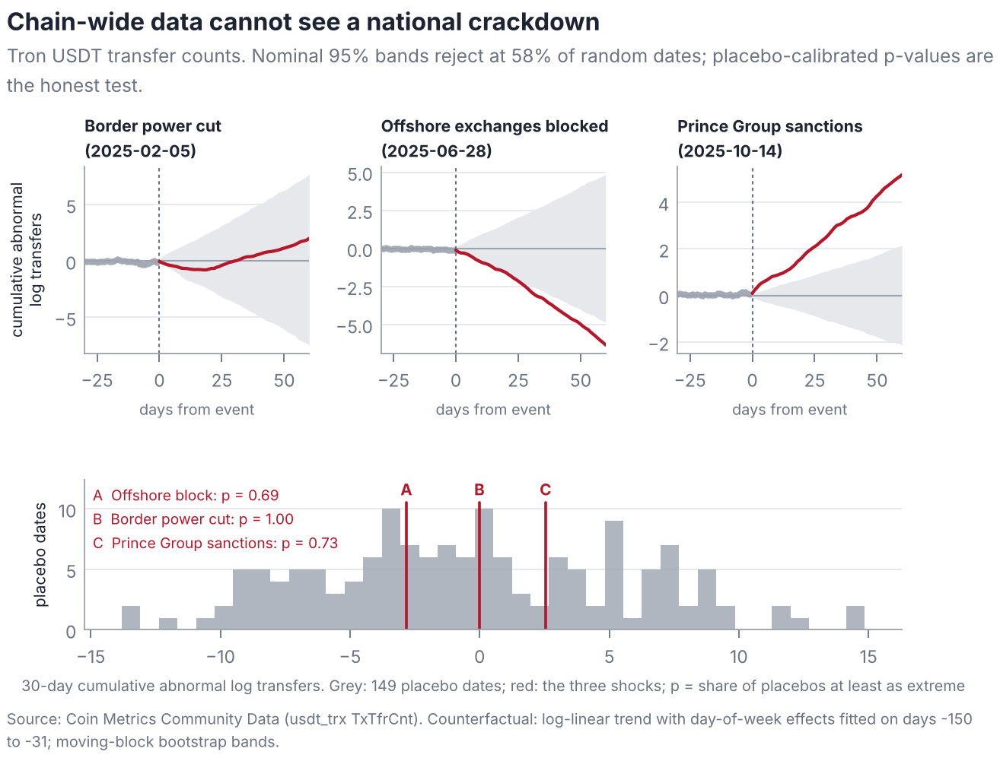
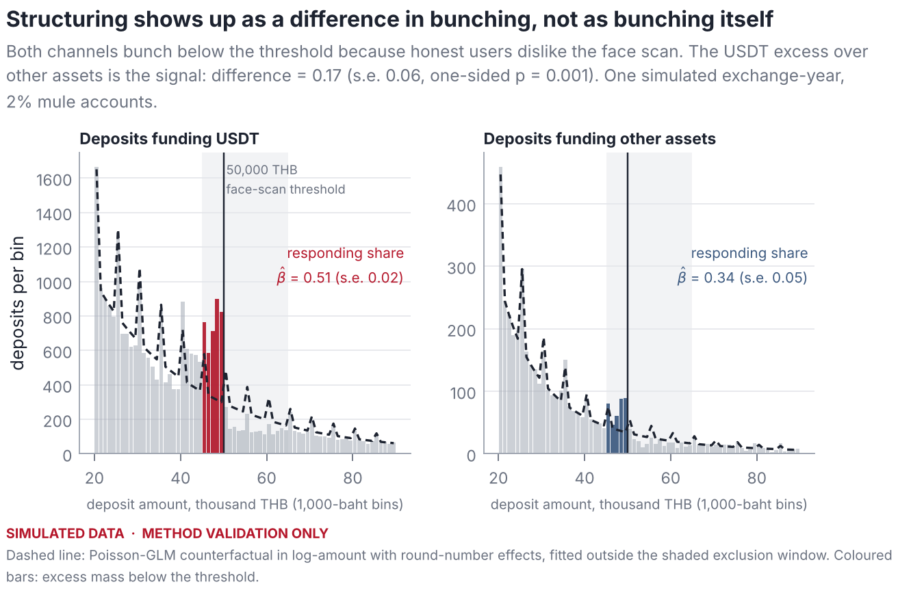
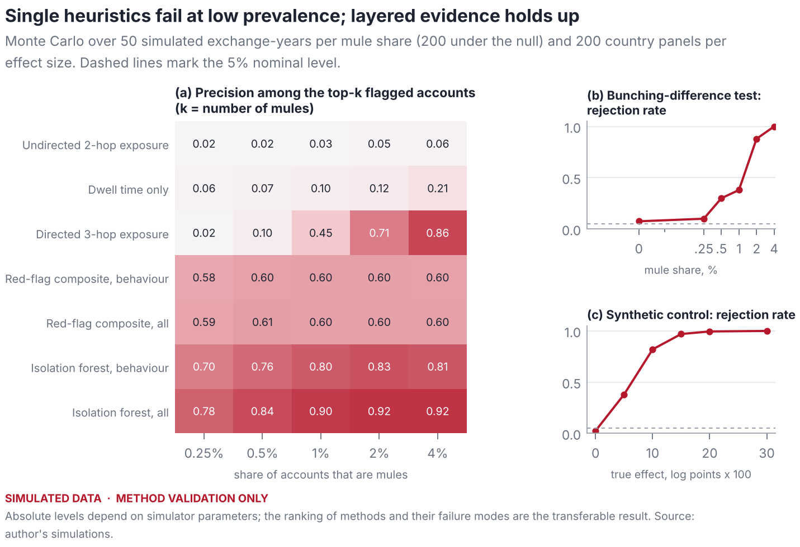

<p align="center"><a href="https://thanatchon36.github.io/shadow-dollars/paper/"></a></p>

<p align="center">
<a href="https://github.com/thanatchon36/shadow-dollars/actions/workflows/ci.yml"></a>
<a href="pyproject.toml"></a>
<a href="https://thanatchon36.github.io/shadow-dollars/paper/"></a>
<a href="paper/paper.pdf"></a>
<a href="docs/data_sources.md"></a>
<a href="LICENSE"></a>
</p>

<p align="center">
📖 <b><a href="https://thanatchon36.github.io/shadow-dollars/paper/">Read the paper online</a></b> ·
📄 <b><a href="paper/paper.pdf">Download the PDF</a></b> ·
🗂️ <b><a href="docs/data_sources.md">Data sources</a></b> ·
📦 <b><a href="arxiv/">arXiv package</a></b> ·
📝 <b><a href="CHANGELOG.md">Changelog</a></b>
</p>

**Stablecoin rails, scam finance and the limits of detection in Thailand.** Public on-chain, sanctions and
macro data show that USDT on Tron is a distinct retail dollar rail and that chain-wide data cannot evaluate national
enforcement. The package then builds four detectors for account-level data (difference-in-bunching at the 50,000-baht
face-verification threshold, dwell-time mixtures, direction-aware graph exposure and synthetic control) and
validates them in an agent-based exchange simulator with planted mule accounts.



> **Simulated data notice.** Section 7 of the paper and every figure labelled *SIMULATED DATA · METHOD VALIDATION
> ONLY* come from the simulator in `src/shadowdollars/simulate.py`. They validate methods against planted ground truth
> and are not evidence about real markets. The public-data results (Section 6) use the vintage recorded in
> `data/raw/MANIFEST.json`. No account-level Thai data were used: the pre-registered plan (Section 8) runs as soon as
> exchange or regulator data are available under the PDPA.

## Install and quickstart

```bash
make setup      # uv venv + dependencies (Python 3.12)
make test       # unit tests for the estimators, a few seconds
make all        # data -> figures -> Monte Carlo (~10 min on one core) -> simulation -> tests -> paper -> web
```

Outputs: `data/processed/` (derived series, Monte Carlo results and `facts_*.json` holding every number quoted in the
paper), `figures/` (vector PDF and PNG), `paper/tables/`, `paper/paper.pdf` and the web reader `docs/paper/`.

| Target | Purpose |
|---|---|
| `data` | Download the public data into `data/raw/` (only missing files) and update `MANIFEST.json` |
| `figures` | Figures and tables from public data; writes `data/processed/facts_real.json` |
| `mc` | Monte Carlo in resumable chunks (`run_mc.sh`, about 10 minutes on one core) |
| `sim` | Figures and tables from the simulation; writes `data/processed/facts_sim.json` |
| `test` | Unit tests |
| `paper` | Compile `paper/paper.pdf` (pdflatex + bibtex when installed, otherwise tectonic) |
| `web` | Web reader → `docs/paper/index.html`, served at <https://thanatchon36.github.io/shadow-dollars/paper/> (pandoc, tectonic, pdftoppm) |
| `banner` | README banner → `docs/assets/banner.png` (real data) |
| `arxiv` | arXiv upload → `arxiv/arxiv_submission.zip` (paper source, with the replication code as `anc/`) |

Random seeds are fixed, so simulation results reproduce exactly. Some data sources update daily, so deleting
`data/raw/` and running `make data` again gives a later vintage than the one in the manifest.

## What the pipeline does

1. **Collect and hash** (`shadowdollars.collectors.public`): Coin Metrics on-chain metrics, Federal Reserve H.10
   exchange rates, World Bank CPI and the OFAC SDN digital-currency addresses, each recorded in
   `data/raw/MANIFEST.json` with URL, retrieval time, size and SHA-256.
2. **Rails and clienteles** (`scripts/figures_real.py`): USDT supply by chain, holders, mean balances and transfers
   per dollar of supply for USDT on Tron and Ethereum and USDC on Ethereum; the USDC exit from Tron.
3. **Macro motive**: Thai inflation and exchange-rate volatility against 23 and 21 comparators, and the Mekong
   neighbours.
4. **Sanctions**: address formats of the sanctioned addresses tagged USDT, TRX and USDC.
5. **Event studies** (`shadowdollars.detectors.causal`): cumulative abnormal flows around three Thai crackdowns, with
   inference calibrated on 149 placebo dates instead of nominal bands.
6. **Detectors** (`shadowdollars.detectors`): difference-in-bunching (`bunching`), dwell-time mixtures and
   direction-aware graph exposure (`flows`), account scoring (`accounts`), synthetic control (`causal`).
7. **Simulation and Monte Carlo** (`shadowdollars.simulate`, `shadowdollars.montecarlo`, `scripts/run_mc.py`):
   exchange-years with five honest populations and mule accounts whose tradecraft varies; precision at k, size and
   power for every detector.
8. **Deliverables**: the preprint (`paper/paper.pdf`), its web reader (`docs/paper/`) and the arXiv bundle. Every
   figure passes an automated check for overlapping text (`figures/qa_overlaps.json`).

## Research: *Shadow Dollars: Stablecoin Rails, Scam Finance and the Limits of Detection in Thailand*

The preprint by Thanatchon Chongmankhong is in [`paper/`](paper/): a PDF in [`paper/paper.pdf`](paper/paper.pdf),
the web version at <https://thanatchon36.github.io/shadow-dollars/paper/>, and its LaTeX source in arXiv layout
([`paper/main.tex`](paper/main.tex), section files, [`paper/refs.bib`](paper/refs.bib); template
[`paper/arxiv.sty`](paper/arxiv.sty)). `make arxiv` packs the source and the replication code into
`arxiv/arxiv_submission.zip`; [`arxiv/arxiv_metadata.txt`](arxiv/arxiv_metadata.txt) holds the title, abstract and
comments for the arXiv form. Every number in the text is read from `data/processed/facts_*.json`.

Key findings:

1. **A distinct rail.** USDT on Tron is a high-turnover, small-balance dollar rail: 47% of covered USDT supply,
   74.5 million funded addresses and 9.3 times the transfer intensity of USDT on Ethereum.
2. **A weak macro motive.** Thai inflation and exchange-rate volatility do not explain heavy stablecoin use; the same
   is not true of neighbouring Laos and Myanmar, whose legitimate dollar demand can flow through Thai channels.
3. **Aggregate data mislead.** Chain-level event studies over-reject at 58% of random dates; with placebo-calibrated
   inference no crackdown is detectable, as a displacement model predicts.
4. **Detect differences, follow direction.** Structuring is identified by the *difference* in bunching between USDT
   and other assets, not by bunching itself; graph exposure must follow the direction of funds.
5. **A ready design.** Six pre-registered hypotheses, decision rules and open code make the Thai question testable as
   soon as exchange or regulator data are available under the PDPA.

| | |
|---|---|
|  |  |
|  |  |

## Repository layout

```
src/shadowdollars/
  config.py                 paths, data URLs, Thai thresholds, events, palette
  collectors/               public.py (download + manifest), local.py (ccxt, TronGrid; not executed)
  detectors/                bunching, flows (dwell, graph exposure), accounts (scoring), causal (SCM, event study)
  simulate.py               agent-based exchange-year with planted mule accounts
  montecarlo.py             Monte Carlo drivers
  style.py                  figure style and overlap QA
scripts/
  figures_real.py           public-data figures and tables
  figures_sim.py            simulation figures and tables
  run_mc.py                 Monte Carlo in resumable chunks (driven by run_mc.sh)
  build_web.py              web reader docs/paper/ from the LaTeX source
  make_banner.py            README banner
data/raw/                   raw public data + MANIFEST.json
data/processed/             derived series, Monte Carlo results, facts_*.json
figures/                    all figures (PDF + PNG), qa_overlaps.json
paper/                      main.tex, sections, refs.bib, main.bbl, tables/, figures/, paper.pdf, reader.html
docs/                       GitHub Pages: paper/ (web reader), assets/ (banner, logo), data_sources.md
arxiv/                      submission/ (upload-ready files), arxiv_metadata.txt, make_arxiv_zip.sh
tests/                      unit tests for the estimators
```

## Limitations

Chain-wide data cannot separate Thai flows from global ones, so the public-data section answers what the rails are,
not who uses them. Detector performance is measured on a simulator whose magnitudes are assumptions; the ranking of
methods and their failure modes are the transferable result. `collectors/local.py` was not executed; verify endpoints
and terms of service before use. Some references and institutional dates are flagged in the paper for verification
against primary sources. No individual is accused of wrongdoing, and no address of a private person is de-anonymised.
See paper §10.

AI assistance: the paper, code and figures were prepared with the assistance of Claude (Anthropic); see the disclosure
section of the paper.

## Citation

See [`CITATION.cff`](CITATION.cff) (GitHub shows a "Cite this repository" button), or:

```bibtex
@misc{chongmankhong2026shadowdollars,
  author = {Chongmankhong, Thanatchon},
  title  = {Shadow Dollars: Stablecoin Rails, Scam Finance and the Limits of Detection in Thailand},
  year   = {2026},
  note   = {Preprint},
  url    = {https://thanatchon36.github.io/shadow-dollars/paper/}
}
```

License: code [MIT](LICENSE). The arXiv template `paper/arxiv.sty` is from
[kourgeorge/arxiv-style](https://github.com/kourgeorge/arxiv-style) (MIT). Paper text and figures: © 2026 Thanatchon
Chongmankhong. Data: subject to each provider's terms ([`docs/data_sources.md`](docs/data_sources.md)).
